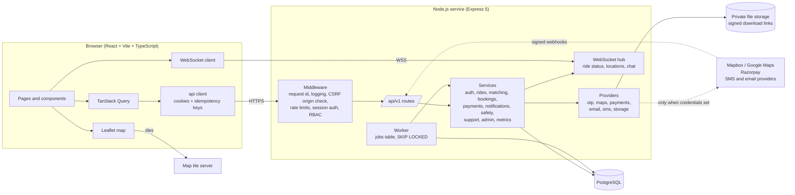

# Architecture

Green Way is a modular monolith: one Node.js service that serves the API, the WebSocket channel, the background worker and the built React app, backed by PostgreSQL.

## Layers

| Layer | Location | Responsibility |
| --- | --- | --- |
| Routes | `backend/src/routes/v1` | HTTP shape only: parse with Zod schemas, call a service, map the result |
| Services | `backend/src/services` | Business rules, state machines, transactions, authorization of objects |
| Repositories | SQL inside services through `db.query` / `db.tx` helpers | Parameterised SQL only; no string-built queries |
| Providers | `backend/src/providers` | Everything external behind interfaces with a development implementation |
| Worker | `backend/src/workers` | Recurring ride generation, booking expiry, reminders, notification retries, location purge |
| Realtime | `backend/src/realtime` | Authenticated WebSocket subscriptions per ride and per user |

## Key decisions

- **Stack.** The brief recommends Next.js and FastAPI, and also says to improve an existing codebase instead of rebuilding it. The repository was a working React + Vite and Node.js/Express app, so the stack stays JavaScript: Express 5 on the server, React + TypeScript + Tailwind on the client. The database moves from MongoDB to PostgreSQL because seat inventory, payments and the booking state machine need relational constraints and row-level locking.
- **Sessions.** Opaque random tokens in an `HttpOnly`, `SameSite=Lax` cookie (`Secure` in production); only a SHA-256 hash is stored. State-changing requests must come from an allowed `Origin`, which blocks CSRF.
- **Seat safety.** Every seat change runs in a transaction that locks the ride's `seat_inventory` row (`SELECT … FOR UPDATE`); a `CHECK` constraint makes overselling impossible even if code is wrong. Booking and payment creation accept an `Idempotency-Key`.
- **Jobs.** A `jobs` table with `FOR UPDATE SKIP LOCKED` workers and unique `dedupe_key`s, so retries never duplicate recurring rides or notifications. Redis is not required for a single instance; rate limits are in-memory and documented as per-instance.
- **Maps.** `maps` provider interface with `mock` (Bengaluru gazetteer, straight-line distance × 1.35 road factor, time-of-day speed, always labelled "estimate") and `mapbox` (geocoding and directions, used when `MAPBOX_TOKEN` is set).
- **Payments.** `payments` provider interface with `simulated` (an in-app checkout page labelled "Simulated payment — no money moves", which posts an HMAC-signed webhook back to the server) and `razorpay` (orders API, payment signature and webhook signature verification). Payment success is only ever accepted from a verified server-side event.
- **Local development** runs a real embedded PostgreSQL server when `DATABASE_URL` is not set, so nothing needs installing.
