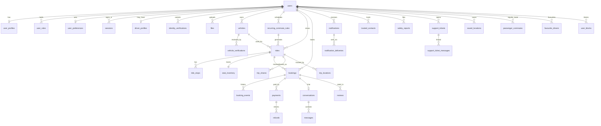

# Database

PostgreSQL 17. The schema lives in `backend/src/db/migrations/` and is applied in order by `npm run migrate` (and automatically on server start), each migration in its own transaction under an advisory lock. All money is integer **paise**; all instants are `timestamptz` in UTC; commute departure times are wall-clock `time` values interpreted in `Asia/Kolkata`.

## Entity relationships

Also: `otp_challenges`, `payment_webhook_events`, `audit_logs`, `platform_config`, `search_events`, `idempotency_keys`, `jobs`, `schema_migrations`.

## Mapping to the brief's table list

| Brief | Here | Note |
| --- | --- | --- |
| users, user_profiles, driver_profiles, identity_verifications, vehicles, vehicle_verifications, rides, ride_stops, recurring_commute_rules, seat_inventory, bookings, payments, refunds, payment_webhook_events, reviews, conversations, messages, notifications, trusted_contacts, safety_reports, support_tickets, audit_logs, user_preferences | same names | |
| ride_instances | `rides` with `recurring_rule_id` + `service_date` | A ride *is* one dated, bookable instance. `UNIQUE (recurring_rule_id, service_date)` stops duplicates when the generator job retries. |
| administrative_roles | `user_roles` | One table for all four roles; permissions per role are defined in `backend/src/lib/permissions.js`. |

## Critical constraints

| Rule | Enforced by |
| --- | --- |
| Seats can never be oversold | `seat_inventory.seats_reserved <= seats_total` (`CHECK`), plus every seat change runs inside a transaction holding `SELECT … FOR UPDATE` on that row |
| One live booking per passenger per ride | Partial unique index `bookings_one_active_idx` on `(ride_id, passenger_id)` where status is REQUESTED/ACCEPTED/CONFIRMED/IN_PROGRESS |
| Retried booking/payment requests don't duplicate | `UNIQUE (passenger_id, idempotency_key)` on bookings; `UNIQUE (payer_id, idempotency_key)` on payments |
| Webhooks are processed once | `UNIQUE (provider, event_id)` on `payment_webhook_events` |
| A refund can't exceed the payment | `CHECK (refunded_paise <= amount_paise)`; refund creation also caps at the remaining amount |
| Recurring generation is idempotent | `UNIQUE (recurring_rule_id, service_date)` on rides |
| One review per side per booking | `UNIQUE (booking_id, reviewer_id)`, `CHECK (reviewer_id <> reviewee_id)` |
| Indian numbers only | `CHECK (phone ~ '^\+91[6-9][0-9]{9}$')` on users and trusted contacts |
| Uploads are small, typed documents | `files` mime type and size `CHECK`s; contents sniffed server-side |
| Lock order (prevents deadlocks) | Code always locks `seat_inventory` → `bookings` → `payments` |

Booking status transitions are enforced in code (`backend/src/services/bookingState.js`), and every change writes a `booking_events` row with the actor and reason.

## Indexes for common paths

- Search: `rides (status, departure_at)` narrows to published rides in the time window before route matching runs in the service.
- Dashboards: `bookings (passenger_id, created_at DESC)`, `rides (driver_id, departure_at DESC)`.
- Queues: `identity_verifications (status, submitted_at)`, `vehicle_verifications (status, submitted_at)`, `support_tickets (status, priority, created_at)`, `safety_reports (status, severity, created_at)`.
- Workers: `bookings (status, expires_at)`, `notification_deliveries (status, next_attempt_at)`, `jobs (status, run_at)`.

## Sensitive data and retention

| Data | Stored | Retention |
| --- | --- | --- |
| Identity documents | Private file storage under random keys; DB keeps type, last 4 characters and hash. Full document numbers are never stored. | Deleted when the account is deleted (worker `purge-files`). Should also follow the verification provider's / legal retention requirement before launch. |
| Live locations | `trip_locations`, only for rides in progress with driver consent | Purged after `safety.location_retention_days` (default 7) by worker `purge-locations` |
| OTP codes | HMAC of code, never the code | Expire after 10 minutes; rows can be pruned |
| Session tokens | SHA-256 hash only | Expire after `SESSION_DAYS` (default 30); revoked on logout or suspension |
| Deleted accounts | Personal fields cleared, status `deleted`; bookings, payments and reviews kept anonymised for other people's records and accounting | Indefinite for financial records (check legal requirement) |

## Demo data

`backend/src/db/seed.js` loads fictional people, vehicles, rides, commutes and bookings. Every demo row has `is_demo = true`; metrics and exports exclude demo data unless "include demo" is chosen, and the UI tags demo records.
